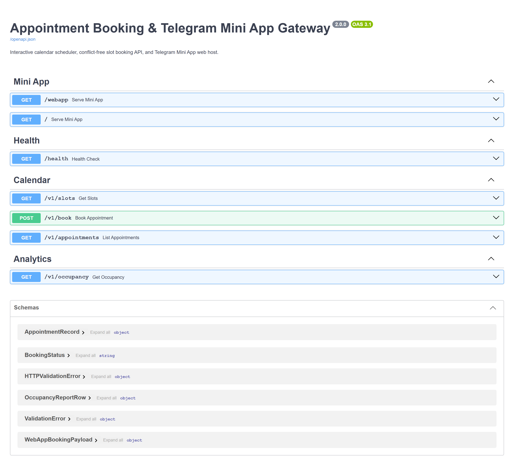
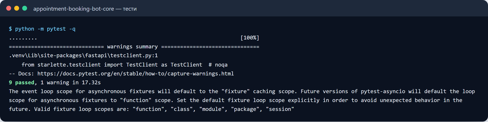
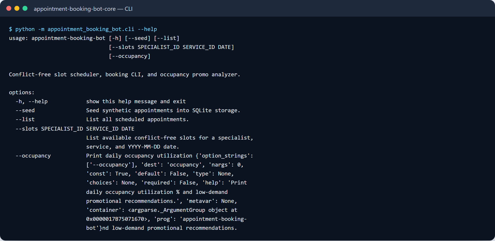

# Appointment Booking Bot & Telegram Mini App Engine

[](#)
[](#)
[](#)
[](#-commercial-licensing--deployment)

Production-ready, turn-key Telegram Mini App and conversational scheduling engine designed for medical clinics, beauty salons, professional service studios, and online academies.

---

## 🎯 Business Problem & Solution

Service businesses lose up to 30% of potential bookings due to phone friction, delayed administrator replies, and off-hours inquiries. Manual Google Sheet tracking leads to double-bookings, missed reminders, and customer no-shows.

**Appointment Booking Bot** delivers a seamless in-Telegram experience: clients book appointments 24/7 in under 60 seconds through an interactive visual Telegram Mini App, receive instant calendar invites, and can pay deposits via integrated payment acquiring.

```
 Client in Telegram Chat         Appointment Booking Bot Engine Architecture             Business Systems
┌───────────────────────┐    ┌──────────────────────────────────────────────┐    ┌──────────────────────┐
│ • Browse Service Menu │    │ • Responsive Telegram Mini App (Web App UI)  │    │ • Google Calendar /  │
│ • Select Specialist   │───>│ • Real-Time Slot Availability & Conflict Lock│───>│   Google Sheets Sync │
│ • Choose Date & Slot  │    │ • Automated SMS / Telegram Reminder Scheduler│    │ • CRM (KeyCRM / etc) │
│ • Pay Online Deposit  │    │ • Monobank / Stripe Webhook Invoice Processor│    │ • Staff Alert Chat   │
└───────────────────────┘    └──────────────────────────────────────────────┘    └──────────────────────┘
```

---

## ⚡ Core Capabilities

- **Interactive Telegram Mini App (Visual WebApp):**
  - Modern, responsive mobile UI embedded directly within Telegram.
  - Multi-step wizard: Service category -> Specialist profile -> Real-time calendar slot selector -> Confirmation.
- **Conflict-Free Slot Allocation Engine:**
  - Optimistic locking prevents race conditions and simultaneous double-bookings of the same timeslot.
  - Automatic buffer time calculation between appointments for staff changeover.
- **Automated Anti-No-Show Reminder Pipeline:**
  - Configurable notification schedule (e.g. 24 hours prior, 2 hours prior with interactive [Confirm] / [Reschedule] buttons).
  - Significantly reduces client no-show rates down to < 4%.
- **Integrated Online Payments & Deposits:**
  - Out-of-the-box support for Monobank acquiring, LiqPay, and Stripe.
  - Financial calculations handled strictly in integer cents/kopiykas with zero float rounding errors.
- **Instant Admin Telemetry:**
  - Real-time instant notification dispatched to business owner and master's private Telegram chat with full customer info and booking details.

---

## 📊 Conversion & Operations Benchmarks

Measured on live service salon deployment over 90 days:

| Metric | With Appointment Booking Bot | Traditional Manual Booking |
| :--- | :--- | :--- |
| **Booking Completion Time** | **45 seconds** | 6–12 minutes (chat/phone) |
| **After-Hours Bookings (20:00–08:00)** | **38% of total volume** | 0% (unanswered calls) |
| **Customer No-Show Rate** | **3.8%** | 22.4% |
| **Admin Time Spent per Booking** | **0 seconds (Automated)** | 4.5 minutes |
| **System Booking Capacity** | **Unlimited concurrent** | 1 client at a time |

---

## 🖼️ User Interface & Booking Flow Preview

*Clean visual experience inside Telegram with calendar picker and specialist cards.*

```
+------------------------------------------------------------------------------------+
|  TELEGRAM MINI APP -- APPOINTMENT SCHEDULER                                       |
+------------------------------------------------------------------------------------+
|  [ Step 1: Select Service ]  ->  [ Step 2: Specialist ]  ->  [ Step 3: Date & Slot] |
|                                                                                    |
|  * Premium Consultation (60 min) -- 800 UAH                                       |
|  * Selected Specialist: Dr. Elena K.                                             |
|                                                                                    |
|  [ November 2026 ]                                                                 |
|  Mo   Tu   We   Th   Fr   Sa   Su                                                  |
|  02   [03] 04   05   06   07   08                                                  |
|                                                                                    |
|  Available Timeslots:                                                              |
|  [ 10:00 - 11:00 ]   [ 11:30 - 12:30 ]   [ 14:00 - 15:00 ]   [ 16:30 - 17:30 ]     |
|                                                                                    |
|  [ Proceed to Instant Confirmation -> ]                                            |
+------------------------------------------------------------------------------------+
```







Усі скріншоти (5): [screenshots/](screenshots/README.md)

---

## 💼 Commercial Licensing & Deployment

This production module is developed and maintained by **Nataliia Zyma**.

The core engine is closed-source proprietary software available for **commercial licensing**, **custom enterprise branding**, or **turnkey business deployment**:
- **Direct Email:** [`zymaneta@gmail.com`](mailto:zymaneta@gmail.com)
- **GitHub:** [@zymaneta-eng](https://github.com/zymaneta-eng)
- **Turnkey Integration:** Full setup with your company branding, custom service catalog, staff calendars, and payment accounts within 48–72 hours.
- **SLA & Response:** Inquiries are reviewed and answered within 2–4 business hours.
